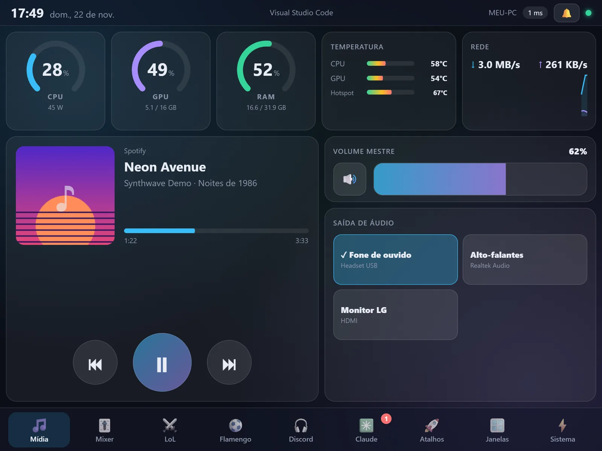

# PC Control Center — iPad como Stream Deck do Windows

Painel de controle em tempo real que roda no Safari de um iPad (feito e testado no iPad Air 2, iPadOS 15) e controla o PC Windows pela rede local via WebSocket. Funciona também em qualquer tablet ou celular com navegador na mesma rede.

**Site com capturas do painel e configurador:** <https://ianlpereira.github.io/ipad-pc-control/>



Volume e mixer por app, música tocando, telemetria (CPU/GPU/RAM/temperaturas), atalhos e macros, janelas e energia. Abas opcionais para League of Legends, placar de futebol ao vivo, Discord e Claude Code.

## Começo rápido

Você precisa de um **PC com Windows 10/11**, **Python 3.11 a 3.13** e o iPad (ou outro aparelho) **na mesma rede** do PC.

1. **Instale o Python** em <https://www.python.org/downloads/> (recomendado: 3.13) e marque **"Add python.exe to PATH"** no instalador.
2. **Baixe este projeto**: botão verde **Code › Download ZIP** no GitHub (extraia numa pasta fixa, ex.: `Documentos\ipad-pc-control`), ou:
   ```powershell
   git clone https://github.com/ianlpereira/ipad-pc-control.git
   ```
3. **Dê dois cliques em `start.bat`**. Na primeira vez ele instala tudo (1 a 3 minutos) e abre o **assistente de configuração**.
4. **Responda o assistente** (Enter aceita o valor sugerido). Ele detecta sozinho o que dá e:
   - mostra o IP do PC e define a porta e o token de acesso;
   - encontra o LibreHardwareMonitor e a placa de vídeo (temperaturas e GPU);
   - liga só as abas que você quer: LoL (acha a pasta do jogo), futebol (escolha o time numa lista das Séries A e B, ou qualquer outro), Discord, Claude Code e a aba Jogos;
   - libera a porta no **Firewall do Windows** (pede permissão de administrador) e avisa se a rede estiver como Pública;
   - opcionalmente faz o servidor **iniciar junto com o Windows**.
5. **No iPad**, abra no Safari a URL que aparece no final (ex.: `http://192.168.0.10:8765/`) e toque em **Compartilhar › Adicionar à Tela de Início** para abrir em tela cheia.

Para refazer a configuração depois: `start.bat --setup` (as respostas atuais viram o padrão e o `config.json` anterior ganha backup). Ajustes finos (botões de atalho, volumes do modo jogo, alertas) ficam no `config.json`; as seções abaixo explicam cada um.

Atualizar: baixe a versão nova por cima (ou `git pull`) e rode o `start.bat`. Ele reinstala as dependências sozinho quando o `requirements.txt` muda. Seu `config.json` não é sobrescrito.

```
┌──────────────────────── iPad Air 2 (Safari 15 / WebClip tela cheia) ────────────────────────┐
│  web/index.html + style.css + app.js  (Vanilla JS ES2017, ~30 KB, sem build, sem framework)  │
│  Topbar · Telemetria fixa (CPU/GPU/RAM/Temp/Rede) · 10 abas · zero scroll · 1024×768          │
└───────────────┬──────────────────────────────────────────────────────────────▲──────────────┘
                │ HTTP GET /  (arquivos estáticos)                             │ state a cada 1 s
                │ WS /ws          {"t":"cmd","a":"audio.master.set","v":0.5}   │ + push após comando
                ▼                                                              │ ack por comando
┌──────────────────────── PC Windows — Python 3.11+ · FastAPI · uvicorn :8765 ───────────────┐
│ main.py  ── Hub WebSocket (broadcast) ── Dispatcher (protocol.py) ───────────────────────┐ │
│   telemetry.py  psutil (CPU/RAM/rede/janela ativa) + LibreHardwareMonitor :8085 (temps/GPU) │
│   audio.py      pycaw/Core Audio: volume mestre, mixer por app, troca de saída (IPolicyConfig)│
│   media.py      WinRT SMTC: música atual, capa, play/pause/next/prev                        │
│   launcher.py   apps, pastas, URLs, scripts .bat/.ps1/.sh/.py, atalhos e macros (config.json)│
│   games.py      detecta jogos (Steam, Epic, GOG, Xbox), abre e fecha pelo iPad                │
│   windows.py    desktops virtuais, Win+D, Alt+F4, snap, screenshot (Pillow)                 │
│   power.py      desligar, reiniciar, suspender, bloquear, reiniciar Explorer, monitor off   │
│   display.py    brilho via DDC/CI (monitorcontrol), atalho para Luz Noturna                 │
└──────────────────────────────────────────────────────────────────────────────────────────────┘
```

**Por que Python + FastAPI?** `pycaw`, `comtypes`, `psutil` e `winrt` dão acesso nativo ao Core Audio, telemetria e SMTC do Windows sem compilar addons nativos (no Node.js o mixer por app exigiria addon C++ ou chamar PowerShell a cada comando). FastAPI/uvicorn é assíncrono, então o WebSocket responde em poucos ms mesmo enquanto scripts rodam. Na LAN, a latência medida fica em 1–15 ms (o valor aparece no topo do painel).

---

## 1. Instalação no PC (detalhes)

O [Começo rápido](#começo-rápido) cobre tudo. Esta seção explica o que o `start.bat` e o assistente fazem, para quem prefere configurar à mão.

| Comando | O que faz |
|---|---|
| `start.bat` | Cria o `.venv` com o Python 3.11+ encontrado (`py -3.13`, `-3.12`, `-3.14`, `-3.11` ou `python`), instala as dependências, abre o assistente se não houver `config.json` e inicia o servidor |
| `start.bat --setup` | Abre o assistente de novo antes de iniciar |
| `start.bat --min` | Inicia com o console minimizado, sem assistente (usado pelo atalho de inicialização) |
| `.venv\Scripts\python.exe -m server.wizard` | Só o assistente, sem iniciar o servidor |

Passos manuais equivalentes ao assistente:

1. Copie `config.example.json` para `config.json` e ajuste (o servidor também cria um a partir do exemplo se ele faltar).
2. **Libere a porta no Firewall** (PowerShell como administrador, só rede **Privada**):
   ```powershell
   New-NetFirewallRule -DisplayName "Control Center iPad" -Direction Inbound -Protocol TCP -LocalPort 8765 -Action Allow -Profile Private
   ```
   Confira se a sua rede Wi-Fi/Ethernet está como **Privada** em Configurações › Rede e Internet.
3. **Reserve um IP fixo** para o PC no roteador (reserva DHCP) para a URL nunca mudar.

### Abas opcionais

Mídia, Mixer, Atalhos, Janelas e Sistema estão sempre ligadas. As outras ligam e desligam em `features`; aba desligada some do iPad e não roda nada em segundo plano:

```json
"features": { "lol": true, "football": false, "discord": false, "claude": false, "games": true }
```

Sem a chave `features`, todas ficam ligadas (compatível com configs antigos).

### Telemetria completa: LibreHardwareMonitor

Temperatura da CPU e uso/temperatura/VRAM da GPU não são expostos pelo Windows a programas comuns. O painel lê do **LibreHardwareMonitor** (gratuito, open source):

1. Baixe em <https://github.com/LibreHardwareMonitor/LibreHardwareMonitor/releases> e extraia.
2. Rode **como administrador**.
3. `Options › Remote Web Server › Run` (porta 8085 padrão). Marque também `Options › Start Minimized`, `Minimize to Tray` e `Run On Windows Startup`.
4. Pronto: o aviso amarelo "Abra o LibreHardwareMonitor" some do painel.

5. Aponte `"lhm_path"` no `config.json` para a pasta do LHM (ex.: `"~/Downloads/LibreHardwareMonitor"`; o assistente procura sozinho). O `start.bat` passa a abri-lo automaticamente se ele ainda não estiver aberto. O Windows mostra o prompt do UAC, porque o LHM precisa de admin. Se o servidor já rodar como admin (tarefa com `/rl highest`), o prompt não aparece. Deixe `"lhm_path": ""` para não abrir. Com `"lhm_minimized": true` (padrão), antes de abrir o LHM o servidor liga *Start Minimized* e *Minimize To Tray* no `LibreHardwareMonitor.config`, e o LHM sobe direto na bandeja.

Sem o LHM, CPU/RAM/rede continuam funcionando; GPU e temperaturas mostram "—".
Se a GPU errada aparecer (ex.: o vídeo integrado do processador em vez da placa dedicada), ajuste `"gpu_name_filter"` com um trecho do nome da placa, ex.: `"4060"` ou `"6700"`. O assistente faz isso quando acha mais de uma placa.

### Iniciar junto com o Windows

O assistente oferece criar o atalho da opção A.

O servidor precisa rodar **na sessão do seu usuário**, porque áudio, teclas simuladas e janelas dependem disso.

**Opção A: atalho minimizado na pasta Inicializar (padrão, sem admin)**

```powershell
powershell -ExecutionPolicy Bypass -File scripts\autostart.ps1          # instala
powershell -ExecutionPolicy Bypass -File scripts\autostart.ps1 -Remove  # remove
```

O script cria `PC Control Center.lnk` em `shell:startup`, apontando para `start.bat --min`. O console abre minimizado na barra de tarefas; clique nele para ver a URL e os logs. Como o servidor roda sem admin, o Windows pede confirmação (UAC) a cada logon para abrir o LibreHardwareMonitor.

**Opção B: tarefa agendada como admin (sem prompt do UAC)**

```powershell
schtasks /create /tn "PC Control Center" /tr "\"C:\caminho\para\ipad-pc-control\start.bat\" --min" /sc onlogon /rl highest
```

Exige um PowerShell de administrador para criar a tarefa. `/rl highest` roda o servidor como admin, o que também permite enviar teclas para jogos e apps elevados (por causa do UIPI, um processo comum não consegue). Se usar a B, remova o atalho da A para não abrir dois servidores.

---

## 2. Conectar o iPad

1. iPad e PC na **mesma rede**. No iPad: Ajustes › Wi-Fi › (i) da rede › desligue **Endereço Wi-Fi Privado**, e reserve um IP para ele no roteador também.
2. Abra no Safari a URL do console (`http://IP:8765/`).
3. **Compartilhar › Adicionar à Tela de Início**. O ícone abre em **tela cheia**, sem barra do Safari (modo standalone).
4. Gire para **paisagem** (o layout também funciona em retrato).

Não há login nem token por padrão. Se você ativar `"require_token": true` (veja Segurança), abra a URL com `?token=...` uma vez; o iPad memoriza.

---

## 3. iPad como painel dedicado 24/7

### Ajustes nativos (sem jailbreak), que resolvem 90% do problema

| Ajuste | Onde |
|---|---|
| Bloqueio automático: **Nunca** | Ajustes › Tela e Brilho |
| **Acesso Guiado**: prende o iPad no WebClip, desativa o botão Home e gestos | Ajustes › Acessibilidade › Acesso Guiado (ligue, defina código, e em *Bloqueio Automático da Tela* escolha **Nunca**). Abra o painel e dê 3 cliques no Home. |
| Brilho automático ligado | Ajustes › Acessibilidade › Tela e Tamanho do Texto › Brilho Automático |
| Modo Pouca Energia **desligado** | Ajustes › Bateria |
| Foco/Não Perturbe **sempre ativo** (banners não cobrem o painel) | Central de Controle › Foco |
| Atualizações automáticas **desligadas** (evita perder o jailbreak) | Ajustes › Geral › Atualização de Software |
| Rotação travada em paisagem | Central de Controle |

Com a tela sempre ligada e o app em primeiro plano, o Wi-Fi **não dorme** e o Safari **não suspende** a aba. O painel ainda tem um watchdog: se ficar 6 s sem receber dados, ele derruba o socket e reconecta sozinho (backoff de 0,5 s a 5 s).

### Jailbreak (iPadOS 15 no A8X)

O A1566 (A8X) é compatível com o **palera1n** (exploit checkm8 de bootrom, não pode ser corrigido pela Apple). Ele é **semi-tethered**: após reiniciar o iPad, você precisa rodar o palera1n de novo pelo PC/Mac. Para um painel que fica sempre na tomada, isso raramente acontece. O gerenciador de pacotes padrão é o **Sileo**. Desde o iOS 15 o jailbreak é **rootless**, então **instale apenas pacotes marcados como rootless (`iphoneos-arm64`)**. Muitos tweaks antigos não foram portados.

Recomendações, por utilidade:

1. **OpenSSH** (repositório Procursus, rootless): administre o painel pelo PC.
   - `uiopen "http://192.168.0.10:8765/"` reabre o painel remotamente (pacote `uikittools`).
   - `sbreload` reinicia o SpringBoard se algo travar.
2. **Ocultar barra de status / modo kiosk**: procure no Sileo por "status bar" ou "kiosk" com suporte a rootless no iOS 15. Sem tweak, o WebClip já usa `black-translucent` e a barra ocupa só 20 px.
3. **Manter Wi-Fi ligado com a tela bloqueada** (tweaks no estilo *Insomnia*): só fazem diferença se você deixar o iPad bloquear. Com "Bloqueio: Nunca" + Acesso Guiado, não são necessários.
4. **AutoTouch / Activator** (se houver versão rootless): automações extras, por exemplo um script que reabre o WebClip caso ele seja fechado.

> **Bateria:** ficar 24/7 na tomada a 100 % incha e degrada a bateria de iPads antigos. O iPad Air 2 não tem limite de carga nativo. Use uma **tomada inteligente** com rotina (carregar de ~40 % a ~80 %) ou deixe-o na tomada só durante o uso.

### Escurecer o iPad à noite

- **Sistema › Escurecer iPad** liga uma camada preta por cima do painel (toque para acordar por 60 s).
- Agendamento automático em `config.json`:
  ```json
  "night_dim": { "enabled": true, "start": "23:00", "end": "07:00", "opacity": 0.75 }
  ```

### Alternativa futura: app nativo via TrollStore

O TrollStore instala apps permanentemente no iOS 15 sem precisar de jailbreak. Um wrapper WKWebView mínimo (`UIApplication.shared.isIdleTimerDisabled = true`, sem barra de status, reconexão nativa) eliminaria o Safari da equação. O web app atual funciona sem mudanças dentro dele.

---

## 4. O painel

| Aba | Conteúdo |
|---|---|
| **Topo (fixo)** | Relógio, janela ativa no PC, hostname, latência (ms), status da conexão. Gauges de CPU/GPU/RAM, barras de temperatura (CPU, GPU, hotspot), rede ↓/↑ com gráfico de 60 s |
| **Mídia** | Música atual (capa, título, artista, progresso) e ⏮ ⏯ ⏭; volume mestre + mute; troca de saída de áudio com 1 toque (headset ↔ caixas) |
| **Mixer** | Faders verticais: mestre + cada app tocando áudio (Discord, Spotify, jogo…), com mute por app; paginação se houver mais de 8 |
| **LoL** (opcional) | Fase do cliente (lobby, fila com tempo, seleção, partida); aceitar partida e aceitar automático; abrir/fechar cliente. Na partida: campeão, KDA, CS, CS/min, visão, participação em abates, placar e tempo |
| **Futebol** (opcional) | Placar ao vivo do seu time, lances, estatísticas, escalações, tabela e próximos jogos |
| **Discord** (opcional) | Canal atual, entrar no canal do grupo com 1 toque, sair, mute/ensurdecer; amigos na call com avatar (acende quem fala), mudo/surdo e volume individual |
| **Claude** (opcional) | Sessões do Claude Code (trabalhando/esperando você/concluído), pedidos de permissão com Permitir/Negar, tokens de hoje e 7 dias, abrir projeto/app/claude.ai |
| **Jogos** (opcional) | Reconhece sozinha os jogos instalados (Steam em todas as bibliotecas/discos, Epic, GOG e Xbox/Game Pass), com capas; abre com 1 toque, mostra quais estão rodando e fecha o jogo (segurar). Veja [Jogos](#jogos-detecção-automática) |
| **Atalhos** | Páginas de botões configuráveis (apps, pastas, sites, scripts, macros) |
| **Janelas** | Desktop anterior/próximo/novo, Visão de tarefas, Alt+Tab, Mostrar desktop, Maximizar, Encaixar, Explorer, Screenshot (salva em `Imagens\ControlCenter`), Recorte, Fechar janela (segurar) |
| **Sistema** | Bloquear, Suspender, Desligar monitor, Reiniciar Explorer, Reiniciar, Desligar (**segurar 1,2 s** para confirmar); brilho dos monitores via DDC/CI; Luz Noturna; escurecer iPad |

Feedback de toque: o botão encolhe e brilha ao tocar, pisca verde quando o PC confirma e vermelho (com mensagem) quando há erro.

**Notificações:** o sino no topo guarda os últimos alertas: fila encontrada, partida começou ou terminou, Claude terminou ou precisa de você, amigo entrou ou saiu da call. Alertas importantes tocam um som e piscam a tela. O iOS só libera som depois do primeiro toque na página.

### League of Legends

Usa as APIs locais oficiais do cliente (LCU) e da partida (Live Client Data). Só mostra informação que já aparece no jogo, seguindo a política de apps de terceiros da Riot.

```json
"lol": {
  "dir": "C:/Riot Games/League of Legends",
  "auto_accept": false,
  "game_mode": { "switch_tab": "lol", "volumes": { "spotify.exe": 0.3, "discord.exe": 1.0 } }
}
```

- **Fila encontrada:** o iPad mostra um botão ACEITAR gigante com contagem, toca um som e pisca a tela. O "Aceitar automático" fica na aba LoL e não é salvo: volta a `auto_accept` quando o servidor reinicia.
- **Modo jogo:** quando a partida começa, o iPad vai para a aba LoL e os volumes de `game_mode.volumes` são aplicados. As chaves são os nomes dos `.exe`, como aparecem no Mixer. Quando a partida termina, ou se o servidor fechar no meio dela, os volumes anteriores voltam. Use `"volumes": {}` para não mexer no áudio.
- **Build da partida:** na seleção de campeões, o painel lê sua posição e o campeão que você está mostrando ou já confirmou. Com isso, busca a build mais popular: runas, feitiços, itens iniciais, core e botas, opções situacionais, ordem de skills e win rate. Em ARAM usa a build de ARAM; na escolha às cegas, a posição mais jogada do campeão. Durante a partida, a build continua no botão **Build** da aba LoL. Os dados vêm da API JSON pública que alimenta o site do op.gg. Ela **não é oficial** e pode mudar sem aviso; nesse caso aparece "build indisponível". Nomes e ícones vêm do próprio cliente do LoL, em português.
- **Importar runas:** o botão cria a página "PC Control: <campeão> <posição>" no cliente e a deixa selecionada. Nas próximas vezes, reaproveita a mesma página. Se todas as suas páginas estiverem ocupadas, renomeie uma delas para começar com **PC Control** no cliente: o painel passa a usar só essa e nunca mexe nas outras.
- **Análise ao vivo:** durante a partida, a aba LoL ganha cinco visões: **Resumo** (ritmo de CS contra a meta da posição, CS aos 10 e 15 min, ouro parado e próximo item da build, gráficos), **Rota** (você contra o oponente da mesma posição), **Times** (placar, valor de itens, composição e dica de armadura ou resistência mágica), **Objetivos** (contagem regressiva de dragão e barão, almas, inibidores) e **Eventos**. Tudo vem da Live Client Data API, só com informação que o jogo já mostra a todos: sem cooldown de inimigos nem rastreio de selva. Valor de itens e dano inimigo são **estimativas**. Os tempos de respawn de objetivos ficam no topo de `server/modules/lol_live.py` e dependem do patch. Ajustes opcionais em `lol.live` (veja `config.example.json`): metas de CS/min por posição, limite de ouro parado e quais alertas notificar (`objective`, `idle_gold`, `death`, `ace`, `inhib`).
- **Começar partida só pelo iPad:** a visão **Lobby/Seleção** da aba LoL abre sozinha e esconde a telemetria. No **lobby** você escolhe a fila (Solo/Duo, Flex, Normal, ARAM...), a 1ª e 2ª rota e toca em **Buscar partida** (ou **Cancelar busca**); segure **Sair do lobby** para sair. Na **seleção de campeões**: contagem da fase, banir/escolher/**travar** (cada toque é uma ação sua, nada é automático), grade com filtro por classe, régua A–Z, os dois times com bans, e um painel com **Runas** (as 3 opções mais populares do op.gg para importar, mais as páginas que você já tem), **Feitiços** (troca do D/F, ou aplica os recomendados), **Inimigos** (mix de dano físico/mágico estimado, seu campeão contra cada inimigo revelado e as melhores respostas a cada um; tocar numa resposta marca o campeão) e **Skin** (ARAM: banco e rerrolar). O iPad avisa quando chega a sua vez de banir ou escolher e quando faltam 10 s. Depois da partida, **Jogar de novo** volta ao lobby. Tudo usa a API local do cliente (LCU); os caminhos ficam em `server/modules/lol_control.py` e podem ser conferidos em `/swagger/v3/openapi.json` da LCU com o cliente aberto.
- **Fechar cliente:** segure o botão. Fecha o cliente do LoL e o Riot Client, que ficam ocupando CPU e RAM sem fazer nada. Fica bloqueado durante a partida.

### Futebol (placar ao vivo)

Feita para o Flamengo, mas serve para qualquer time coberto pelo ESPN. Ligue em `features.football`. A aba (nome em `flamengo.label`) mostra o jogo em andamento: placar, relógio, lances (gols, cartões, substituições), estatísticas, escalações, narração e a tabela do campeonato. Fora de jogo, mostra a contagem para o próximo jogo e o último resultado; a visão **Jogos** lista os próximos e os últimos resultados com a sequência de V/E/D. Cobre todas as competições do time (Brasileirão, Libertadores, Copa do Brasil, estaduais).

```json
"flamengo": {
  "team_id": "819",
  "label": "Flamengo",
  "auto_switch": false,
  "alerts": { "goal": true, "kickoff": true, "red_card": true, "period": true, "final": true }
}
```

- **Fonte:** API pública do ESPN, sem chave. **Não é oficial** e pode mudar sem aviso; nesse caso a aba mantém o último valor e mostra "Placar indisponível". O placar tem atraso de algumas dezenas de segundos em relação à TV. O servidor consulta a cada 10 s durante o jogo e bem mais devagar fora dele.
- **Alertas:** gol do seu time toca som e destaca a tela; gol do adversário, início, intervalo, vermelho e fim de jogo avisam em silêncio (vermelho do seu time com som). Cada tipo liga e desliga em `alerts`. Ao ligar o servidor no meio do jogo, ele não avisa lances que já aconteceram.
- **`team_id`:** o id do time no ESPN. O assistente (`start.bat --setup`) mostra a lista das Séries A e B para escolher pelo número; para outro time, o id está no link da página dele: `espn.com.br/futebol/time/_/id/819/flamengo` → `819`. **`label`:** nome da aba. **`auto_switch`:** o iPad vai para a aba no gol e no início do jogo.

### Discord (painel do grupo)

O Discord só libera controle de voz (RPC) para apps do próprio usuário. Configure uma vez (o assistente pergunta os mesmos dados e abre o portal para você):

1. Em <https://discord.com/developers/applications>, **New Application** (o nome é livre, ex.: "PC Control").
2. Em **OAuth2**, copie o **Client ID**, gere e copie o **Client Secret** e adicione o Redirect `http://localhost`.
3. Pegue o ID do canal de voz do grupo: ative em Configurações › Avançado › **Modo de desenvolvedor**, clique com o botão direito no canal e escolha **Copiar ID do canal**.
4. No `config.json`:
   ```json
   "discord": { "client_id": "…", "client_secret": "…", "group_channel_id": "…", "redirect_uri": "http://localhost" }
   ```
5. Reinicie o servidor. Na aba Discord do iPad, toque em **Entrar no grupo**. O Discord do PC abre um pedido de autorização: aceite uma vez. O token fica em `data/discord_token.json`.

### Claude Code (alertas e aprovação)

Instale os hooks uma vez (o assistente oferece). Isso altera a configuração **global** do Claude Code (`~/.claude/settings.json`), sempre com backup:

```bash
.venv\Scripts\python.exe scripts\install_claude_hooks.py
```

Para remover: `... install_claude_hooks.py --remove`. Vale para sessões novas do Claude Code.

- **Alertas:** o iPad avisa quando uma sessão termina ou fica esperando você, e lista as sessões com o status.
- **Aprovar pelo iPad:** desligado por padrão. Com ele desligado, nada muda no Claude Code: o hook responde na hora e a pergunta aparece no PC como sempre. Ligue em **Aprovar pelo iPad** na aba Claude quando sair de perto do PC. A partir daí, cada pedido de permissão espera até 120 s pela resposta no iPad. Sem resposta, volta para o prompt normal no PC; nunca aprova sozinho.
- **Segurança:** só os IPs em `claude.trusted_ips` (o IP reservado do iPad) podem ligar o modo ou decidir. Os hooks só aceitam conexões do próprio PC (127.0.0.1).
- **Uso de tokens:** soma os registros locais de `~/.claude/projects` (inclui tokens de cache). Projetos para o botão "Abrir": `claude.projects`.

---

## 5. Configurando atalhos (`config.json`)

O `config.json` é gerado a partir do `config.example.json`. Reinicie o servidor após editar.

```json
"launcher": [
  { "name": "Apps", "buttons": [
    { "id": "chrome",  "label": "Chrome",  "icon": "🌐", "type": "app",    "target": "chrome.exe" },
    { "id": "obs",     "label": "OBS",     "icon": "🎥", "type": "app",    "target": "C:/Program Files/obs-studio/bin/64bit/obs64.exe",
      "cwd": "C:/Program Files/obs-studio/bin/64bit" },
    { "id": "dl",      "label": "Downloads","icon": "📥", "type": "folder", "target": "~/Downloads" },
    { "id": "yt",      "label": "YouTube", "icon": "▶️", "type": "url",    "target": "https://youtube.com" },
    { "id": "spot",    "label": "Spotify", "icon": "🎵", "type": "url",    "target": "spotify:" },
    { "id": "backup",  "label": "Backup",  "icon": "💾", "type": "script", "target": "scripts/backup.ps1", "confirm": true },
    { "id": "tm",      "label": "Tarefas", "icon": "📊", "type": "keys",   "keys": "ctrl+shift+esc" },
    { "id": "sig",     "label": "Assinar", "icon": "✍️", "type": "macro",
      "steps": [ { "text": "Abraços," }, { "keys": "enter" }, { "delay": 100 }, { "text": "Seu Nome" } ] }
  ]}
]
```

| Campo | Descrição |
|---|---|
| `type` | `app`, `folder`, `url` (também `spotify:`, `steam://`, `ms-settings:`), `script` (`.bat` `.cmd` `.ps1` `.py` `.sh`), `keys`, `macro` |
| `args`, `cwd` | argumentos e pasta de trabalho (app/script) |
| `hidden` | script roda sem janela |
| `confirm` | exige segurar o botão para disparar |
| `color` | cor de fundo CSS do botão, ex. `"rgba(56,189,248,.3)"` |
| Teclas | `ctrl shift alt win tab enter esc space backspace delete home end pageup pagedown left up right down f1–f24 a–z 0–9 printscreen media_playpause media_next media_prev volume_up volume_down volume_mute` e símbolos `; = , - . / [ ] \ '` |

Até 18 botões por página (6×3). Caminhos relativos de scripts partem da pasta do projeto (`scripts/`). Scripts `.sh` usam o `bash` do Git for Windows ou do WSL.

#### Jogos (detecção automática)

A aba **Jogos** varre as lojas ao iniciar o servidor (e no botão **↻ Procurar jogos**) e guarda o resultado em `data/games.json`:

- **Steam**: lê `libraryfolders.vdf` e os `appmanifest_*.acf` de todas as bibliotecas (outros discos incluídos); ignora Proton, runtimes e redistribuíveis. Capas vêm do cache local da Steam.
- **Epic**: manifestos em `ProgramData\Epic\EpicGamesLauncher\Data\Manifests`.
- **GOG**: registro do Windows (abre pelo GOG Galaxy quando instalado).
- **Xbox / Microsoft Store**: pacotes de jogo (com `MicrosoftGame.config`), como os do Game Pass.

Quem não tem capa mostra o ícone do `.exe`. Jogos de outras lojas (Riot, Battle.net, EA...) ou escondidos entram pelo `config.json`:

```json
"games": {
  "hide": ["Steamworks", "steam-123456"],
  "extra": [
    { "label": "Valorant", "type": "app",
      "target": "C:/Riot Games/Riot Client/RiotClientServices.exe",
      "args": ["--launch-product=valorant", "--launch-patchline=live"] },
    { "label": "Battle.net", "type": "url", "target": "battlenet://" }
  ]
}
```

`hide` aceita o id (`steam-ID`, `epic-NOME`...) ou um trecho do nome. "Fechar" encerra só processos cujo `.exe` está dentro da pasta de instalação do próprio jogo.

Outras opções: `port`, `tick_seconds` (intervalo de telemetria), `lhm_url`, `gpu_name_filter`, `net_exclude` (interfaces ignoradas no cálculo de rede), `audio_device_hide` (oculta saídas virtuais como "Steam Streaming"), `screenshot_dir`.

---

## 6. Segurança

- **Por padrão não há autenticação** (`"require_token": false`): qualquer dispositivo conectado à mesma rede que abrir `http://IP:8765` controla o PC, inclusive desligar e rodar os scripts do `config.json`. Isso é aceitável numa rede doméstica só sua. Se houver convidados no Wi-Fi, Wi-Fi sem senha forte ou rede compartilhada, ative `"require_token": true` no `config.json`: o WebSocket passa a exigir o `token` (código 4401 se errado) e o console mostra a URL com `?token=...`.
- O iPad **nunca envia comandos ou caminhos livres**: ele manda só o `id` de um botão (ou de um jogo), e o que cada um executa existe apenas no `config.json` ou no scan feito pelo próprio PC.
- Ações de energia exigem `{"confirm": true}` no servidor, além do gesto de segurar na interface.
- Libere a porta só no perfil de rede **Privado**. Não exponha a porta 8765 para a internet: o tráfego é HTTP sem TLS, feito para a LAN.

---

## 7. Protocolo (para estender)

```jsonc
// iPad -> PC
{"t":"cmd","id":7,"a":"audio.app.set","v":{"key":"discord.exe","volume":0.35}}
// PC -> iPad
{"t":"ack","id":7,"ok":true,"r":null}
{"t":"state","sys":{...},"audio":{...},"media":{...},"ts":1732123456.7}   // 1x por segundo
{"t":"config","host":"DESKTOP","launcher":[...],"night_dim":{...}}         // ao conectar
```

Ações disponíveis: `ping`, `audio.master.set|mute`, `audio.app.set|mute`, `audio.device.set`, `media.toggle|next|prev`, `launcher.run`, `games.list|run|close|rescan`, `win.desktop_prev|desktop_next|desktop_new|task_view|alt_tab|minimize_all|maximize|snap_left|snap_right|explorer|close|screenshot|snip|screenshots_folder`, `power.lock|sleep|restart|shutdown|explorer|monitor_off`, `display.list|set|nightlight`, `lol.accept|decline|auto_accept|open_client|close_client`, `discord.join_group|leave|mute|deaf|user_volume`, `claude.permission.decide|remote|launch`, `notify.clear`.

Mensagens extras do servidor: `{"t":"notify",...}` (alerta), `{"t":"notify_list","items":[...]}` (histórico ao conectar) e `{"t":"event","name":"switch_tab","tab":"lol"}`. Módulos novos registram estado com `STATE_PROVIDERS["nome"] = (coroutine, timeout)` em `server/main.py`.

Nova ação: crie uma função no módulo, registre com `d.on("modulo.acao", func)` no `register()` e use `data-action="modulo.acao"` num botão do HTML.

---

## 8. Problemas comuns

| Sintoma | Solução |
|---|---|
| `start.bat` diz "Python 3.11 ou mais novo nao encontrado" | Instale o Python 3.13 marcando "Add python.exe to PATH" e abra o `start.bat` de novo |
| Quero mudar o que respondi no assistente | `start.bat --setup` |
| iPad fica em "Conectando…" | Firewall (`start.bat --setup` oferece liberar a porta), rede marcada como Pública, IP do PC mudou, ou PC e iPad em redes/VLANs diferentes (Wi-Fi de convidados) |
| "Token inválido" (só com `require_token: true`) | Copie o token atual do `config.json` / console |
| GPU/temperaturas com "—" | LibreHardwareMonitor fechado, sem admin ou sem o Remote Web Server ligado |
| Teclas não funcionam em um jogo | O jogo roda como admin: rode o servidor como admin (`/rl highest`). Alguns anti-cheat bloqueiam entrada simulada |
| Brilho "sem DDC" | Ative DDC/CI no menu do monitor. Notebooks e algumas TVs não suportam |
| Mídia mostra "Nada tocando" | O app precisa aparecer no controle de mídia do Windows (Win+A/volume). Spotify desktop e navegadores funcionam |
| Suspender hiberna em vez de suspender | `powercfg /hibernate off` |
| Wheels falham no `pip install` | Use Python 3.12 ou 3.13: instale, apague a pasta `.venv` e rode o `start.bat` |
